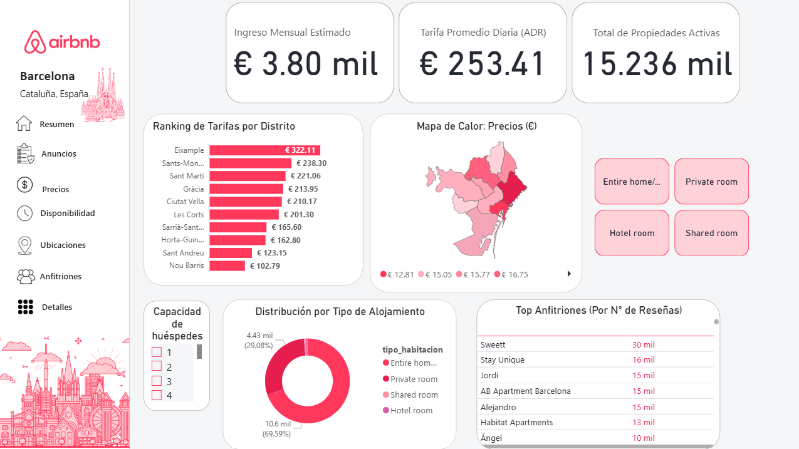
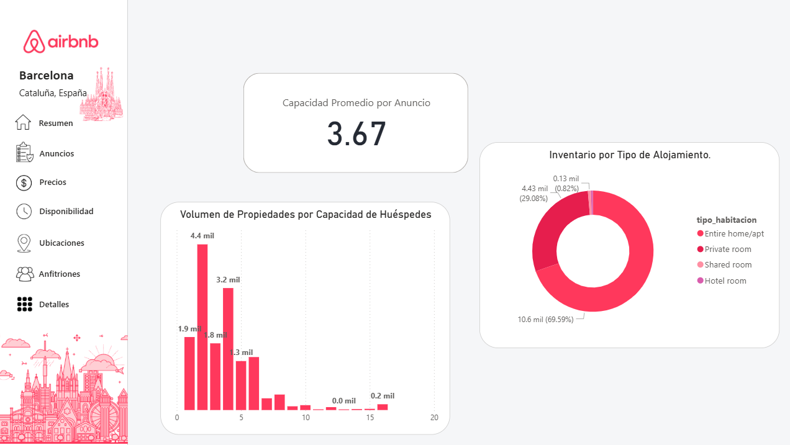
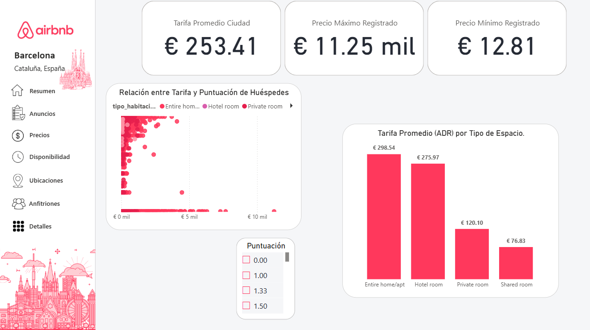
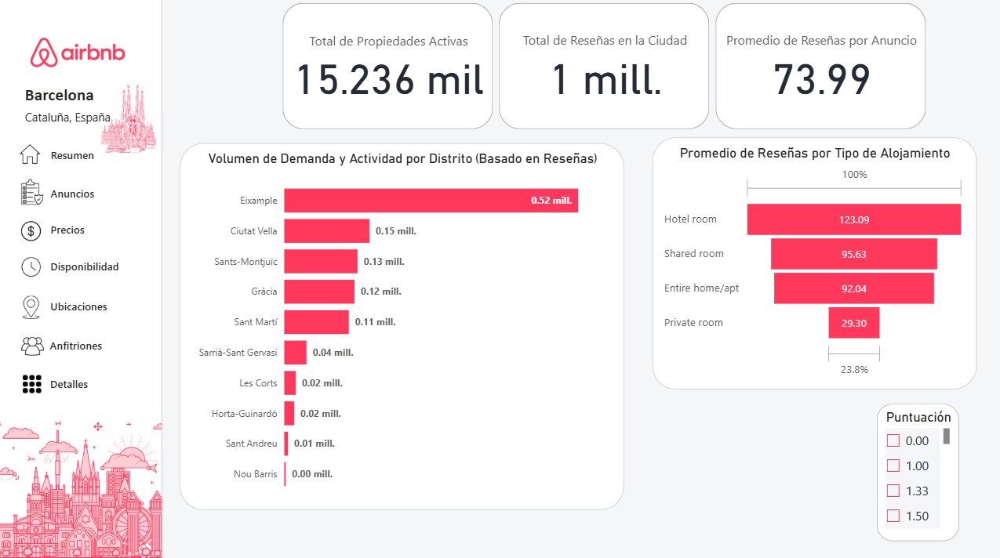
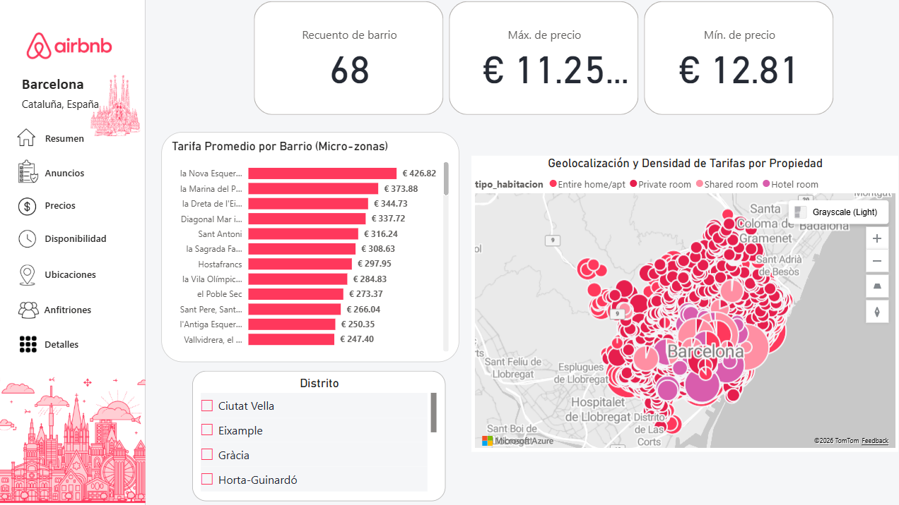
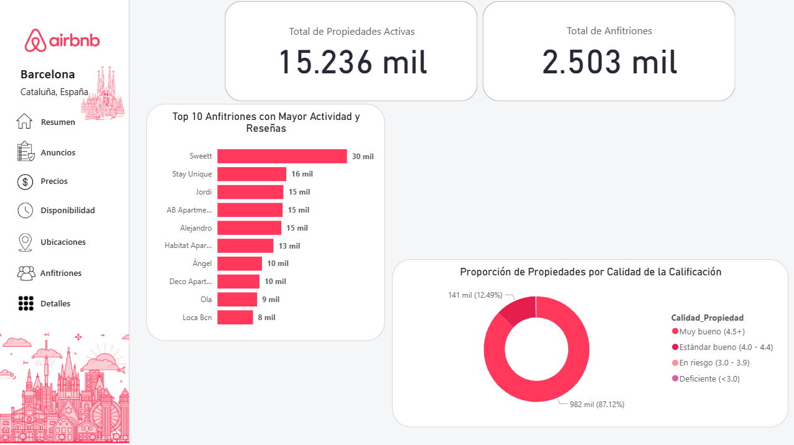
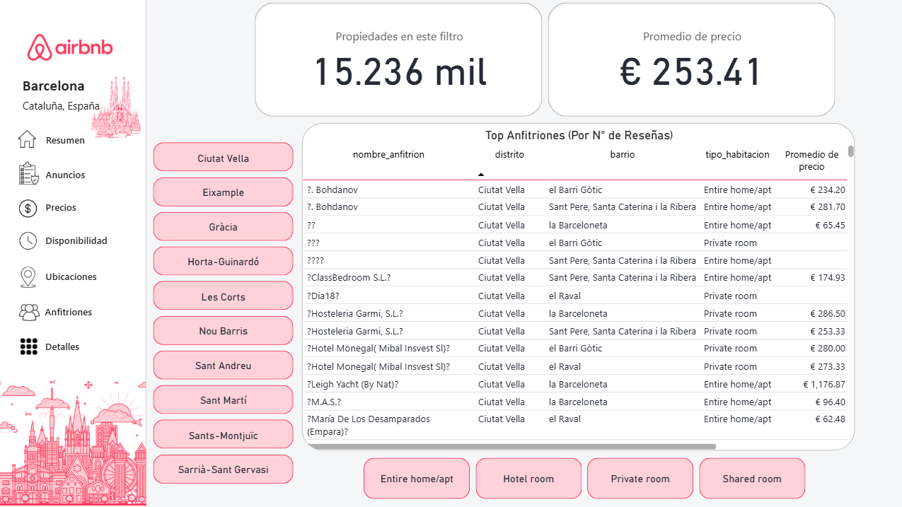

# Airbnb Barcelona: Pipeline Analítico End-to-End & Estrategia de Pricing


[Haz clic aquí para interactuar con el Dashboard en vivo](https://app.powerbi.com/groups/me/reports/97b40e9f-beef-4dea-beab-36845f6f5f59?ctid=717b9a79-1b91-41ab-a6f7-a579b46a9b41&pbi_source=linkShare)

## 1. Contexto y Problema de Negocio
El mercado de alquileres vacacionales a corto plazo en **Barcelona (Cataluña, España)** es uno de los más competitivos y regulados de Europa. Un grupo de inversión inmobiliaria necesita identificar en qué distritos y barrios adquirir nuevas propiedades, qué tipología ofrece el mayor retorno de inversión (ROI) y cómo fijar tarifas competitivas sin sacrificar la ocupación.

Este proyecto abarca el ciclo de vida completo del dato (**End-to-End Data Analytics**): desde la extracción y limpieza de datos crudos en **Python**, pasando por la validación y consultas de negocio en **MySQL**, hasta el diseño de un producto analítico interactivo de 7 módulos en **Power BI**.

---

## 2. Arquitectura y Stack Tecnológico
1. **Ingesta y Limpieza (Python - Pandas):** Estandarización de tipos de datos, limpieza de caracteres especiales en tarifas, tratamiento metodológico de valores nulos y exportación del dataset optimizado (`listings_limpio.csv`).
2. **Almacenamiento y Consultas (MySQL Workbench):** Modelado relacional y ejecución de consultas SQL avanzadas (`GROUP BY`, `HAVING`, funciones de agregación y métricas calculadas).
3. **Modelado DAX y Visualización UI/UX (Power BI Desktop):** Construcción de indicadores financieros, mapas coropléticos personalizados (**TopoJSON Shape Maps**), **Tooltips** dinámicos y navegación multipágina estilo aplicación web.

---

## 3. Criterio Analítico en el Tratamiento de Datos (ETL)
Durante la auditoría de los **15,236 anuncios activos**, se detectaron ~2,600 registros sin precio publicado y ~800 sin historial de reseñas ni puntuación. 
* **Decisión técnica:** En lugar de eliminar filas masivamente (lo cual sesgaría el volumen real de inventario por distrito) o imputar promedios arbitrarios (lo que distorsionaría la realidad financiera), **se conservaron los registros íntegros** para el conteo de oferta física y se aislaron los valores `null` exclusivamente en las agregaciones DAX de tarifas y calificaciones.

---

## 4. Consultas Estratégicas en SQL
Se desarrollaron 3 scripts principales en MySQL para auditar el negocio antes de la fase visual:

```sql
-- 1. Mapa de la Riqueza: Tarifa Promedio por Distrito
SELECT 
    distrito,
    COUNT(id_anuncio) AS total_departamentos,
    ROUND(AVG(precio), 2) AS precio_promedio_noche
FROM alojamientos
GROUP BY distrito
ORDER BY precio_promedio_noche DESC;

-- 2. Estimación de Ingresos Mínimos (Proxy por Tracción de Reseñas)
SELECT 
    titulo_anuncio,
    nombre_anfitrion,
    distrito,
    precio,
    cantidad_resenas,
    (precio * cantidad_resenas) AS ingresos_estimados_minimos
FROM alojamientos
WHERE cantidad_resenas > 0 
ORDER BY ingresos_estimados_minimos DESC
LIMIT 10;

-- 3. Oportunidades "Value for Money" (Alta calificación + Precio competitivo)
SELECT 
    barrio,
    COUNT(id_anuncio) AS cantidad_propiedades,
    ROUND(AVG(precio), 2) AS precio_promedio,
    ROUND(AVG(puntuacion), 2) AS puntuacion_promedio
FROM alojamientos
GROUP BY barrio
HAVING cantidad_propiedades > 30
ORDER BY puntuacion_promedio DESC, precio_promedio ASC
LIMIT 10;
````
## 5. Estructura del Dashboard en Power BI (7 Módulos)
El reporte fue diseñado bajo la identidad visual de Airbnb `(#FF385C)` e incorpora navegación lateral interactiva:. 
* **Módulo 1 - Resumen (Executive Overview)** KPIs macro, ranking de tarifas por distrito, mapa de calor personalizado (.topojson) y distribución del mercado por tipo de alojamiento.

* **Módulo 2 - Anuncios (Inventory):** Análisis de la infraestructura física y distribución de la oferta según la capacidad de huéspedes.

* **Módulo 3 - Precios (Financial Pricing):** Análisis de dispersión (Calidad vs. Tarifa), precios extremos (Piso/Techo) y comparativa de ADR (Average Daily Rate).

* **Módulo 4 - Disponibilidad y Demanda:** Evaluación de la rotación y tracción de reservas por distrito utilizando el volumen de reseñas como proxy de ocupación.

* **Módulo 5 - Ubicaciones (Geospatial Deep-Dive):** Geolocalización exacta por latitud/longitud y desglose microeconómico a nivel de Barrio.

* **Módulo 6 - Anfitriones (Host Performance):** Identificación de operadores líderes, concentración de portafolios y segmentación de calidad mediante DAX (SWITCH).

* **Módulo 7 - Detalles (Operative Raw Data):** Matriz de auditoría con buscador dinámico de texto por anfitrión y anuncio.


## Fórmulas DAX Destacadas
```power bi
// Estimación conservadora de flujo de caja (50% ocupación mensual = 15 noches)
Ingreso Mensual Estimado = AVERAGE(alojamientos[precio]) * 15

// Clasificación automática de reputación del alojamiento
Calidad_Propiedad = 
VAR Puntuacion = alojamientos[puntuacion]
RETURN
SWITCH(
    TRUE(),
    ISBLANK(Puntuacion), "Sin puntuación",
    Puntuacion >= 4.5, " Muy bueno (4.5+)",
    Puntuacion >= 4.0, " Estándar Bueno (4.0 - 4.4)",
    Puntuacion >= 3.0, " En Riesgo (3.0 - 3.9)",
    " Deficiente (<3.0)"
)
````
## 6. Hallazgos Clave (Business Insights)
* **Liderazgo en Tarifas (ADR):** La tarifa promedio en Barcelona se sitúa en € 253.41/noche, proyectando un ingreso bruto estimado de € 3,800 mensuales (al 50% de ocupación). El distrito de Eixample lidera la rentabilidad con € 322.11/noche, seguido por Sants-Montjuïc (€ 238.30) y Sant Martí (€ 221.06).
* **Dominio de Propiedades Completas:** El 69.59% (10.6 mil) del inventario corresponde a departamentos enteros (Entire home/apt), mientras que las habitaciones privadas representan el 29.08% (4.43 mil).
* **Profesionalización de Anfitriones:** El mercado muestra una fuerte presencia de gestores corporativos como Sweett (~30 mil reseñas acumuladas), Stay Unique y AB Apartment Barcelona, quienes concentran el mayor tráfico turístico de la ciudad.
* **Oportunidades de Arbitraje:** El análisis de dispersión demuestra que un precio elevado no garantiza satisfacción; existen micro-zonas con tarifas por debajo de la media y calificaciones superiores a 4.5 estrellas ideales para nuevos inversores.

## 👤 Autor
Daniel Oscar Cordero Tinco

Analista de Datos | Ciencias Administrativas (UNMSM)

LinkedIn • Portafolio


